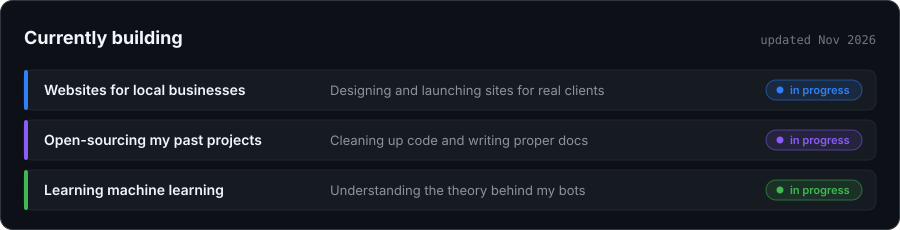
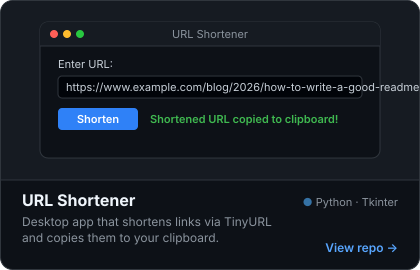
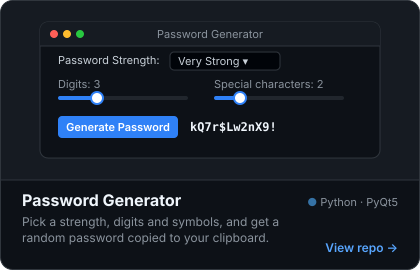
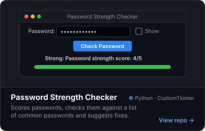
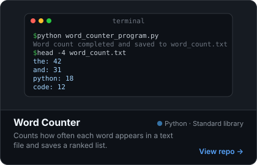

  

  
  
  
  
  
  
  

  
  

## About

I'm an Applied Computing student who has been tinkering with tech since 2018. **Machine learning is my favourite area.** I love building projects with it, like training Rocket League bots, and I'm working on understanding the theory behind them. I also work in **Python** and **web development**, and I'm happiest debugging: working out *why* something broke and fixing it properly. I use AI tools in my workflow, and I make sure I understand everything I ship.

## Featured project

GigaLearnGPU connects two open-source projects: the [GigaLearnCPP](https://github.com/ZealanL/GigaLearnCPP-Leak) bot trainer and the [RocketGPU](https://github.com/thecosmicskye/RocketGPU) physics engine. With it, every match is simulated together on the graphics card instead of one at a time on the CPU. I wrote the bridge between them, sped up rollouts with half-precision inference and optional async PPO, and patched RocketGPU to build on Windows with MSVC.

## Where I started

My first Python programs, from when I was learning the basics. I keep them here to show how far I've come.

  
  
  
  

<b>Get in touch</b>

 

The easiest way to reach me is by email: **connordaviesetech@gmail.com**

The images on this page are generated by <code>scripts/build_assets.py</code>.
